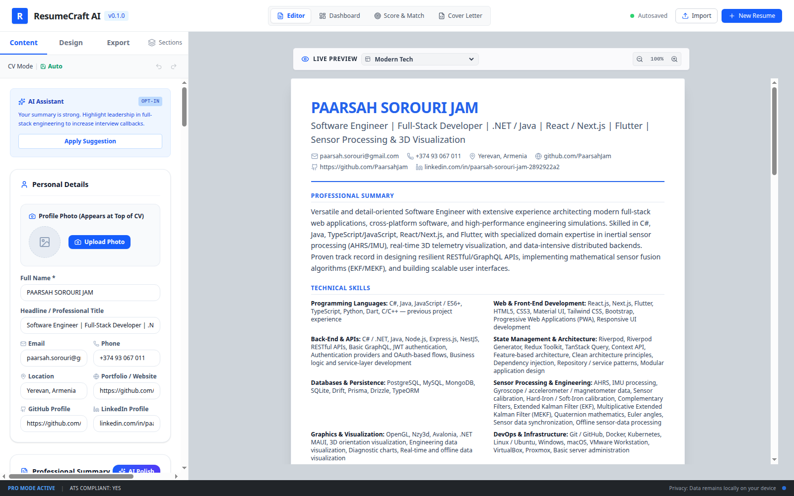
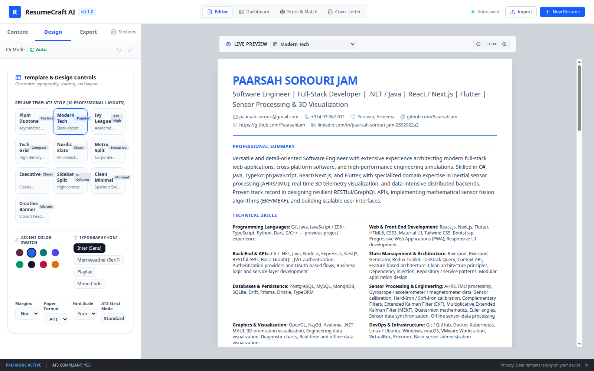
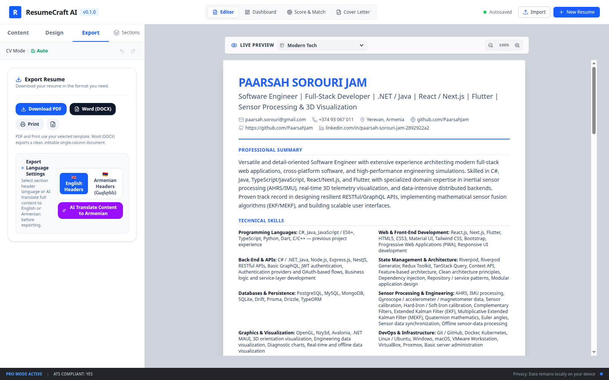
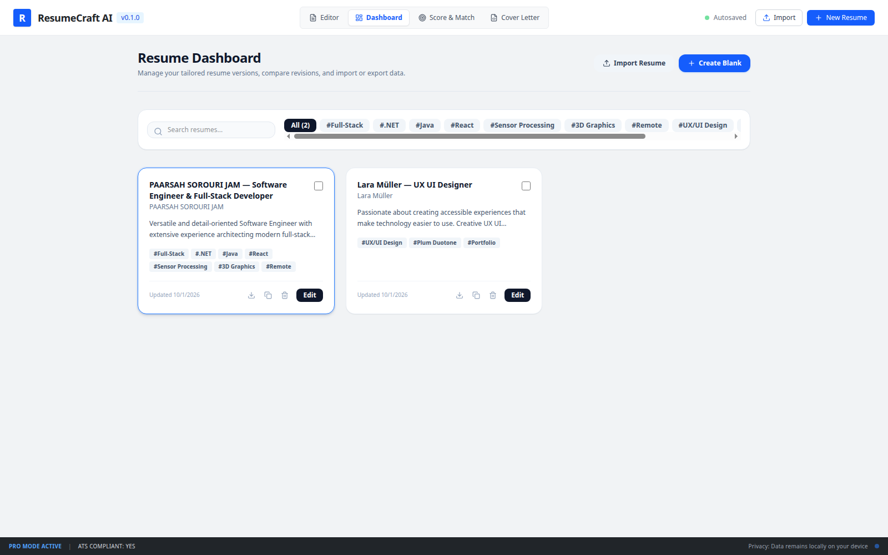
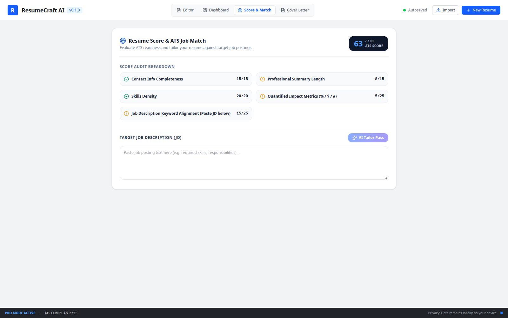
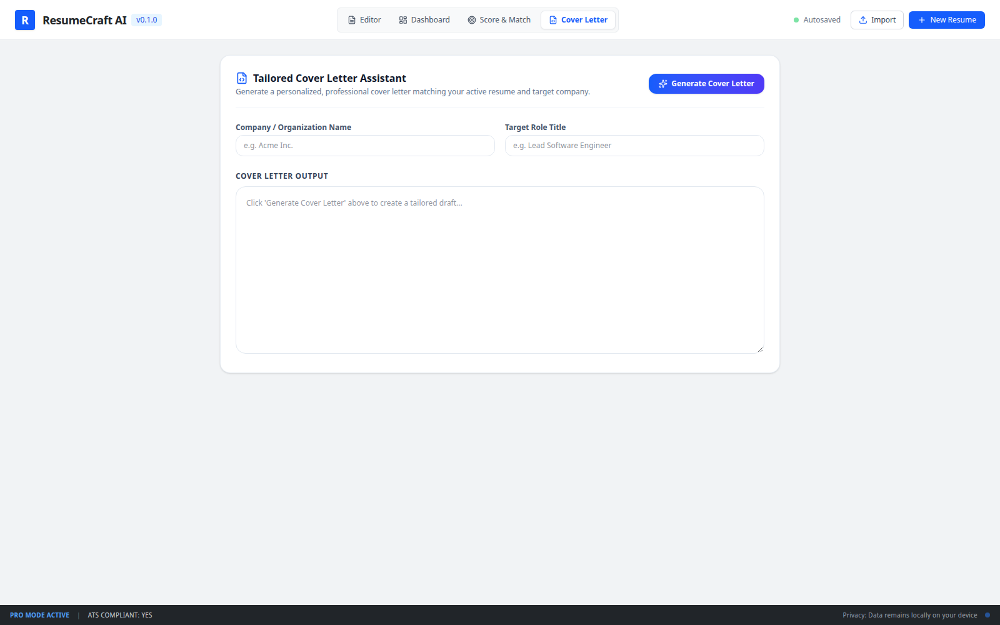
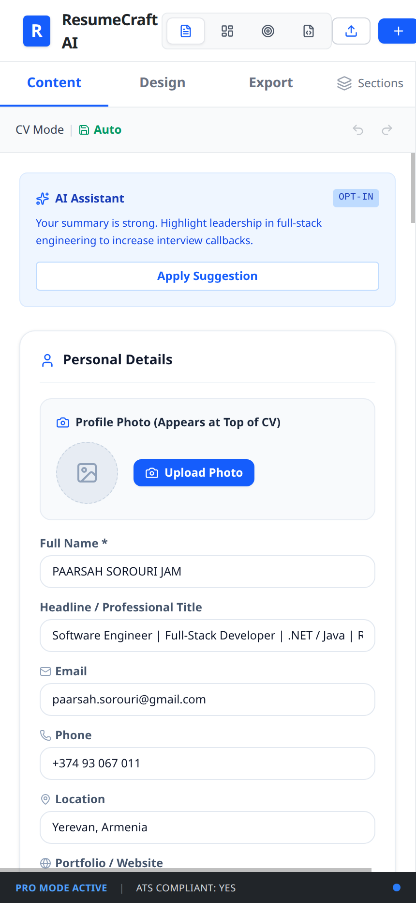
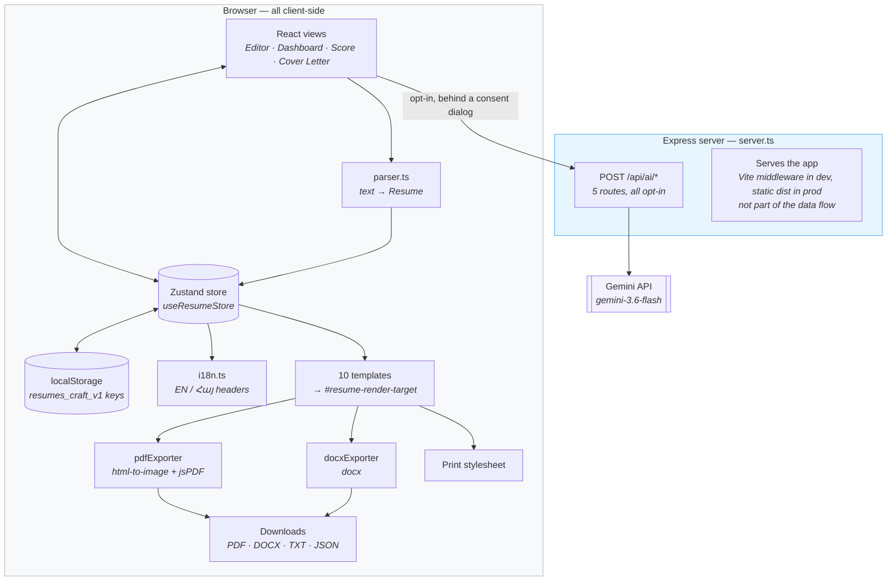

<div align="center">

# ResumeCraft AI

**Build an ATS-ready resume, see it live in ten layouts, and export a PDF that never cuts
a line in half.**

[](https://nodejs.org)
[](https://www.typescriptlang.org)
[](https://react.dev)
[](https://vite.dev)
[](https://tailwindcss.com)
[](https://ai.google.dev)
<!-- Bump this version badge by hand on release; the in-app badge is wired to package.json. -->
[](#)

[Quick start](#quick-start) · [Features](#features) · [Architecture](#architecture) · [FAQ](#faq) · [Troubleshooting](#troubleshooting)

</div>

---

An AI-assisted resume builder. Write or paste your CV once, see it rendered live in ten
print-ready layouts, score it against a job description, and export a PDF, an editable
Word document, or a plain-text cover letter.

Resumes are stored in the browser. Nothing is uploaded unless you explicitly opt in to an
AI feature, and each AI call is gated behind a consent dialog that says exactly what will
be sent.

- **Version:** `0.1.0`
- **Stack:** React 19 + Vite 6 + TypeScript, Express 4 backend, Tailwind CSS 4, Zustand
- **AI:** Google Gemini via `@google/genai` (model `gemini-3.6-flash`)

> **Naming note.** The product name is **ResumeCraft AI** everywhere: `metadata.json`, the
> UI header, the AI consent dialogs, and the server startup log. The version badge in the
> header is injected from `package.json` at build time (`define` in `vite.config.ts`), so it
> always matches the released version rather than a hardcoded string.

---

## Screenshots

All screenshots are captured from a real running instance (Chrome, 1600×1000 unless noted).

| Editor — content | Editor — design | Editor — export |
| --- | --- | --- |
|  |  |  |

| Dashboard | Score & match | Cover letter |
| --- | --- | --- |
|  |  |  |

The editor collapses to a single column on small screens (430×932, 2× scale):

| Mobile |
| --- |
|  |

> Captured from a running dev server via the Chrome DevTools Protocol at a 1600×1000
> viewport (mobile at 430×932, 2× scale), driving the real UI so each view is in its
> natural state. To refresh them after a UI change, re-run that capture — plain
> `google-chrome --screenshot` will not work, because each shot needs a different view
> selected first.

---

## Table of contents

- [Screenshots](#screenshots)
- [Features](#features)
- [Tech stack](#tech-stack)
- [Requirements](#requirements)
- [Quick start](#quick-start)
- [Configuration](#configuration)
- [npm scripts](#npm-scripts)
- [Project structure](#project-structure)
- [Architecture](#architecture)
  - [Data flow](#data-flow)
  - [Views](#views)
  - [Resume data model](#resume-data-model)
  - [State and persistence](#state-and-persistence)
  - [Templates](#templates)
  - [Import pipeline](#import-pipeline)
  - [Export pipelines](#export-pipelines)
  - [AI endpoints](#ai-endpoints)
- [API reference](#api-reference)
- [Deployment](#deployment)
- [Troubleshooting](#troubleshooting)
- [FAQ](#faq)
- [Contributing](#contributing)
- [Changelog](#changelog)
- [Housekeeping](#housekeeping)
- [Known limitations](#known-limitations)
- [License](#license)

---

## Features

### Editor

- Structured editors for personal details, summary, skills, experience, projects,
  education, certifications, languages, and arbitrary custom sections.
- Profile photo upload with an interactive crop-and-frame modal (circle, rounded, square,
  or hidden).
- Reorder sections and toggle their visibility; the chosen order is honoured by every
  template and by the DOCX exporter.
- Undo / redo across 50 snapshots.
- Live preview of the active template with 60–130% zoom.
- Per-role and per-bullet AI rewriting.

### Dashboard

- Multiple saved resumes with create, rename, duplicate, delete, and tag support.
- Side-by-side diff of any two resumes.
- Per-resume JSON backup export.

### Templates and design

Ten layouts (see [Templates](#templates)), plus:

- 8 accent colors.
- 4 typography options (sans, serif, display serif, monospace).
- 3 margin densities and 3 font scales.
- A4 or US Letter paper.
- **ATS Strict Mode** — neutralises accent colors and suppresses the photo and the DOCX
  photo embedding so a parser sees plain, single-column text.

### Import

Paste plain text or Markdown, upload a `.md` / `.txt` file, or start from a bundled
English or Armenian sample. A live preview shows what the parser detected before you
commit.

### Scoring and tailoring

- A local, network-free ATS score out of 100 with a five-part audit breakdown.
- Optional "AI Tailor Pass" against a pasted job description, returning a JD match
  percentage, matched keywords, missing keywords, and concrete tailoring suggestions.

### Cover letters

- Generates a 3–4 paragraph tailored draft from your resume, the target role, and the
  company.
- One editable letter per resume, autosaved, exportable as `.txt`.

### Internationalisation

- Section headers in **English** or **Armenian (Հայերեն)**.
- Full resume translation between the two languages via Gemini.

### Export

| Output | Mechanism | Honours the template? |
| --- | --- | --- |
| **PDF** | `html-to-image` + `jsPDF`, custom pagination | Yes |
| **Word (`.docx`)** | `docx` | No — clean single-column document |
| **Print** | Browser print dialog via a styled popup | Yes |
| **JSON backup** | `Blob` download | n/a — raw data |
| **Cover letter `.txt`** | `Blob` download | n/a |

Every generated filename carries a local timestamp, e.g.
`Alex-Morgan-Resume-2026-09-30_14-32.pdf`, so successive exports never overwrite each
other.

---

## Tech stack

| Layer | Choice |
| --- | --- |
| UI | React 19, TypeScript 5.8, Tailwind CSS 4 |
| Build | Vite 6, esbuild (server bundle) |
| Server | Express 4, run through `tsx` in development |
| State | Zustand 5 |
| Icons / animation | `lucide-react`, `motion` |
| PDF | `jsPDF`, `html-to-image` |
| DOCX | `docx` |
| AI | `@google/genai` |

---

## Requirements

- **Node.js 20+** (developed and verified on Node 24). The AI SDK declares `node >= 20`.
- A **Gemini API key** — optional. Without it every editor, template, scoring, import and
  export feature still works; only the five AI endpoints return an error.

> Both `package-lock.json` (npm) and `bun.lock` (Bun) are committed. Pick one and delete
> the other if you want a single source of truth — currently they can drift.

---

## Quick start

```bash
# 1. Install dependencies
npm install

# 2. Configure the environment (optional — needed only for AI features)
cp .env.example .env
# then edit .env and set GEMINI_API_KEY

# 3. Start the dev server
npm run dev
```

Open **<http://localhost:3000>**.

The dev script (`tsx server.ts`) runs Express and mounts Vite in middleware mode, so a
single process serves both the API and the app with hot module replacement. There is no
separate Vite dev server to start.

On first launch the store seeds two demo resumes (an English software-engineer CV and a
UX/portfolio CV that includes a photo) so there is something to look at immediately.

### Production build

```bash
npm run build
NODE_ENV=production npm start
```

`npm run build` emits the client bundle to `dist/` and bundles the server to
`dist/server.cjs`. `NODE_ENV=production` is **required** — without it the server also
boots but serves the app through Vite instead of the static bundle.

---

## Configuration

| Variable | Required | Default | Purpose |
| --- | --- | --- | --- |
| `GEMINI_API_KEY` | For AI features | — | Google Gemini API key. Read by `server.ts`. Every `/api/ai/*` route returns HTTP 500 without it. |
| `NODE_ENV` | For production | — | `production` serves `dist/`; anything else mounts Vite in middleware mode. |
| `DISABLE_HMR` | No | unset | Set to `true` to disable Vite HMR and file watching (useful in containerised agent workflows). |
| `APP_URL` | No | — | **Declared in `.env.example` but never read by the code.** Safe to delete. |

Environment values are loaded by `dotenv` from `.env` in the project root. `.env*` is
git-ignored; `.env.example` is tracked.

There is **no `PORT` environment variable** — the server hardcodes port `3000`
(`server.ts:11`). Change the constant, or front the process with a proxy, if you need a
different port.

---

## npm scripts

| Script | What it does |
| --- | --- |
| `npm run dev` | Express + Vite in middleware mode on port 3000, with HMR. |
| `npm run build` | `vite build` then `esbuild` the server to `dist/server.cjs`. |
| `npm start` | Run the built server (`dist/server.cjs`). Set `NODE_ENV=production`. |
| `npm run preview` | Vite's static preview server for `dist/` — **API routes are unavailable.** |
| `npm run lint` | `tsc --noEmit`, the only automated check in the project. |
| `npm run clean` | Remove `dist/` and `server.js`. |

---

## Project structure

```
.
├── server.ts                  # Express app: /api routes + Vite/static hosting
├── vite.config.ts             # React + Tailwind plugins, @ alias, DISABLE_HMR handling
├── metadata.json              # App name/description metadata
├── index.html                 # Vite entry document
└── src/
    ├── main.tsx               # React root
    ├── App.tsx                # Header, view switcher, import modal
    ├── types.ts               # Resume, TemplateOptions, and all item types
    ├── index.css              # Tailwind import + print styles
    ├── lib/
    │   ├── parser.ts          # Markdown/plain-text → Resume (local, no API)
    │   ├── pdfExporter.ts     # Paginated PDF generation
    │   ├── docxExporter.ts    # Word document generation
    │   └── i18n.ts            # EN/Armenian section titles + language detection
    ├── store/
    │   └── useResumeStore.ts  # Zustand store, localStorage persistence, undo/redo
    ├── data/
    │   └── sampleResume.ts    # Bundled demo resumes (EN + Armenian, with/without photo)
    └── components/
        ├── ResumeRenderer.tsx        # Template switch; owns #resume-render-target
        ├── builder/                  # Editor shell: sidebar + live preview
        ├── editor/                   # Per-section editors, photo crop, section reorder
        ├── design/                   # Template, colour, typography, paper, ATS controls
        ├── export/                   # Export buttons + language settings
        ├── score/                    # ATS score + JD match
        ├── coverletter/              # Cover letter generator
        ├── dashboard/                # Resume list + version diff
        ├── import/                   # Markdown/text import modal
        └── templates/                # The ten layout components
```

---

## Architecture

### Data flow

Everything except the five AI calls happens in the browser. The server is a thin proxy for
Gemini and a static file host — it never sees a resume unless an AI feature is invoked.



Two consequences worth internalising:

- **There is no server-side data store.** If `localStorage` is cleared, every resume is
  gone. The JSON export is the only backup.
- **The AI boundary is narrow and explicit.** Exactly five routes leave the device, and each
  one is user-initiated behind a consent dialog that names the data being sent.

### Views

The header switches between four top-level views (`AppView` in `src/types.ts`), plus a
modal diff view:

| View | Component |
| --- | --- |
| **Editor** | `ResumeBuilderView` — Content / Design / Export sidebar and the live preview |
| **Dashboard** | `ResumeDashboard` — manage and compare saved resumes |
| **Score & Match** | `ResumeScorePanel` — ATS score and JD analysis |
| **Cover Letter** | `CoverLetterModule` |
| *(diff)* | `VersionDiffModal` — compare two resumes |

### Resume data model

A `Resume` (`src/types.ts`) is a flat, JSON-serialisable object: `meta`, `personal`,
`summary`, and arrays for `skills`, `experience`, `projects`, `education`,
`certifications`, `languages` and `additionalSections`, plus `sectionOrder` and
`hiddenSections` which drive rendering order globally.

Design settings live separately in `TemplateOptions` (paper size, margins, font, font
scale, accent colour, ATS mode, header language) and are shared across all resumes.

### State and persistence

`useResumeStore` is the single Zustand store. Content updates are synchronous in memory
and written to `localStorage` after a 300 ms debounce; design options and cover letters
are written immediately. There is no backend for persistence.

| Key | Contents |
| --- | --- |
| `resumes_craft_v1_resumes` | All saved resumes |
| `resumes_craft_v1_active_id` | Currently selected resume |
| `resumes_craft_v1_options` | `TemplateOptions` |
| `resumes_craft_v1_cover_letters` | Saved cover letters |

The header shows `Saving...` / `Autosaved` based on that debounce.

Consequences worth knowing:

- Data is per-browser and per-origin. Clearing site data deletes every resume.
- A resume payload from `localStorage` or from an AI translation is normalised on load, so
  a malformed record degrades to empty arrays rather than crashing a template.
- To reset the app to the bundled samples, clear those four keys in DevTools.

### Templates

`ResumeRenderer` switches on a `TemplateId` and renders one of ten components into a root
`<div id="resume-render-target">`. That id is the contract the exporters and the print
stylesheet rely on — changing it will break PDF, DOCX and print output.

| Id | Name | Character |
| --- | --- | --- |
| `modern-tech` | Modern Tech | Accent bar and tech-stack badges (default) |
| `minimal` | Clean Minimal | Spacious Swiss monochrome |
| `executive` | Executive Serif | Centred serif with divider rules |
| `two-column` | Sidebar Split | Full-height coloured sidebar |
| `creative` | Creative Banner | Vibrant header card |
| `ivy-league` | Ivy League | Academic, legal and finance |
| `compact-grid` | Tech Grid | High-density engineering |
| `nordic-slate` | Nordic Slate | Minimal editorial with timeline rail |
| `metro-split` | Metro Split | Director-level monogram badge |
| `plum-duotone` | Plum Duotone | Asymmetric two-tone with plum sidebar |

Templates receive `TemplateOptions` and derive their own padding, type scale and colours.
ATS Strict Mode is handled inside each template rather than by a wrapper.

### Import pipeline

`src/lib/parser.ts` turns pasted text or an uploaded `.md` / `.txt` file into a full
`Resume`. It is entirely local and deterministic — no API call. It runs in three passes:

1. **Explicit tags** — lines like `[SECTION: EXPERIENCE]`, `[JOB TITLE]`, `[BULLET]`,
   `[SKILL]`, `[EMAIL]` are consumed as labelled fields.
2. **Heading detection** — `#`-prefixed headings are matched, strictly, against a table of
   ~50 aliases covering both English and Armenian.
3. **Per-section line handling** — bullet markers (`-`, `*`, `•`), pipe-delimited field
   rows (`Job Title | Company | Location | Dates`), comma/semicolon-separated inline
   lists, and date ranges (`2021 – Present`).

An ~110-entry skill blacklist guarantees that a technology name such as `Docker` or
`React` is never mistaken for a section heading.

### Export pipelines

**PDF** (`src/lib/pdfExporter.ts`) is the most intricate part of the codebase. It clones
the live `#resume-render-target` node into an offscreen container at the exact paper width
(794 px for A4, 816 px for Letter at 96 DPI), waits for `document.fonts.ready`, then
measures and paginates before rasterising.

Two constraints drive the design:

- A PDF page clips to the **physical page**, not to the margin box. Drawing one tall strip
  on every page and shifting it would let the strip bleed into the margins, reprinting the
  neighbouring lines and slicing them at the break. Each page is therefore rasterised as
  its own crop: `height` defines the crop viewport while the element keeps its full height
  and a `translateY` offset.
- A page must cover exactly the range up to the **next page's start**, not the full page
  capacity — otherwise a break snapped back to a safe boundary makes adjacent pages
  overlap and cut the line at the break.

Breaks are taken between **sibling block boxes**, the only offsets that cannot land inside
a line box. Inline and absolutely-positioned children are skipped because their edges can
fall mid-line. Per-line text boxes are the fallback for a block taller than a page, and a
hard cut is the last resort so an oversized element cannot loop forever. Content is drawn
inside a 10 mm margin, and the preview's `min-height` is cleared so a short resume does not
spill onto a near-empty second page.

If PDF generation throws, `ExportControls` falls back to the print dialog automatically.

**DOCX** (`src/lib/docxExporter.ts`) builds a real, editable single-column document with
`docx`. It honours the accent colour, section order, hidden sections, header language and
ATS mode (which suppresses the photo), and embeds the profile photo as a centred
`ImageRun` re-encoded as a square PNG. It deliberately ignores the selected template.

### AI endpoints

All five are optional and gated behind an in-app consent dialog. The server uses
`@google/genai` with model `gemini-3.6-flash` and returns JSON matching a
`responseSchema` (except cover-letter generation, which returns text). Failures produce
HTTP 500 with `{ error }`.

| Route | Sends | Returns |
| --- | --- | --- |
| `/api/ai/improve-summary` | Summary, headline, target role | `{ concise, executive }` |
| `/api/ai/improve-bullet` | One bullet, role, company | `{ impact, concise, technical }` |
| `/api/ai/tailor-jd` | Resume summary/skills/experience, job description | `{ score, matchedKeywords, missingKeywords, suggestions }` |
| `/api/ai/generate-cover-letter` | Resume, job description, company, role | `{ body }` |
| `/api/ai/translate-resume` | Entire resume, target language | Full translated `Resume` |

The prompts explicitly instruct the model not to invent employers, degrees, dates or
metrics that are not in the source text. That is a prompt-level guardrail, not a
validation step — review generated content before sending it to a recruiter.

---

## API reference

| Method | Path | Auth | Description |
| --- | --- | --- | --- |
| `GET` | `/api/health` | none | `{ status: 'ok', time }` |
| `POST` | `/api/ai/improve-summary` | API key | Rewrite the professional summary |
| `POST` | `/api/ai/improve-bullet` | API key | Rewrite one bullet, three ways |
| `POST` | `/api/ai/tailor-jd` | API key | ATS match against a job description |
| `POST` | `/api/ai/generate-cover-letter` | API key | Draft a tailored cover letter |
| `POST` | `/api/ai/translate-resume` | API key | Translate a resume EN ↔ HY |

Request bodies are JSON, capped at 10 MB. There is no user authentication — anyone who can
reach the server can use the API and exhaust the Gemini quota. Bind it to localhost or put
it behind your own auth before exposing it.

---

## Deployment

The app is a single Node process: build the client, then run the bundled server with
`NODE_ENV=production`. It works as-is on Cloud Run, Render, Railway, Fly.io or a VM.

```bash
npm ci
npm run build
NODE_ENV=production npm start
```

Things to handle for a public deployment:

- **The port is hardcoded to 3000**, so set your platform's port to 3000 or change
  `server.ts`.
- **Serve over HTTPS.** The Gemini calls send resume content off-device, and an HTTP origin
  will be blocked by some browsers for clipboard and file APIs the UI uses.
- **Set `GEMINI_API_KEY` as a secret**, never in the repository.
- **There is no auth, rate limiting, or per-user isolation.** Add them before opening it up
  beyond a trusted audience.
- `npm run preview` does **not** serve the API — it only previews the static bundle.

---

## Troubleshooting

**AI buttons return an error, everything else works.**
`GEMINI_API_KEY` is unset or invalid. Confirm `.env` exists and that
`curl -s localhost:3000/api/health` responds. Each AI route throws explicitly when the key
is missing.

**The dev server does not start.**
Something is already on port 3000 — the port is not configurable. Vite also logs
`Re-optimizing dependencies` on first boot after an install; that is normal and only slow.

**PDF export falls back to the print dialog.**
The PDF path threw. Exporting uses DOM-to-image rasterisation, which needs the preview to be
rendered — make sure you are on the Editor tab with the preview visible, and check the
browser console for the underlying error.

**My resume vanished.**
Resumes live in `localStorage` under `resumes_craft_v1_*`. Clearing site data, using a
different browser, or a private window will show an empty list. There is no server-side
backup except the JSON export.

**A PDF line looks cut in half at a page break.**
Open the generated PDF in a viewer and zoom in — if the line is intact there, the artefact
is the viewer. The paginator deliberately leaves the bottom of a page slightly empty rather
than splitting a line box, so a little extra bottom whitespace on the last page is
expected.

**New build shows stale data.**
The store replaces its stored copy of the demo resume with the bundled version, and
re-injects the bundled samples if missing. If your own resume was renamed to
`demo-sample-resume`, clear the four `resumes_craft_v1_*` keys.

---

## FAQ

**Does my resume leave my device?**
Only when you press a button that calls an AI feature, and only after you accept the
consent dialog describing what is sent. Editing, templates, scoring, import and every export
format are fully client-side. The server has no database and stores nothing.

**Where is my data, and can I back it up?**
In your browser's `localStorage`, under four `resumes_craft_v1_*` keys. Use **Export JSON**
per resume for a portable backup, and the Import modal accepts it back as text. Clearing
site data, switching browser, or using a private window all start you from the seeded
samples again.

**Do I need a Gemini API key?**
No — only for the five AI features (AI Polish, AI bullet rewrites, AI Tailor Pass, cover
letter generation, and translation). Everything else works with no key at all.

**Which export should I send to a recruiter?**
PDF if the posting is ATS-gated, because the layout is a true single column and the text
stays selectable. DOCX if the recruiter asked for an editable file. Use ATS Strict Mode
either way — it removes colour and the photo, which some parsers mishandle.

**Why does my exported PDF end with a bit of empty space?**
The paginator will never split a line box, so it breaks early enough to keep a line intact
and leaves the remainder of that page empty. A small gap is the correct trade; a
half-character on the next page is not.

**Is the ATS score objective?**
It is a fixed local heuristic over five factors (contact completeness, summary length,
skill count, quantified metrics, and JD keyword overlap). It is a checklist, not an
assessment of your worth. Treat the **missing keywords** list as the actionable output and
ignore the number.

**Can I write my resume in Armenian?**
Yes. The Import parser accepts Armenian section headings, two Armenian sample resumes are
bundled, and section headers plus the whole document can be translated EN ↔ HY.

**Why is a template missing from the preview dropdown?**
The Design tab lists all ten layouts; the preview dropdown is a separate list that currently
omits **Plum Duotone**. Selecting it in the Design tab still works. See
[Known limitations](#known-limitations).

**The DOCX doesn't look like my chosen template. Is that a bug?**
No. DOCX is deliberately a clean, editable single-column document that ignores the template
but does honour your accent colour, section order, hidden sections, and header language.

---

## Contributing

Contributions are welcome. There is no contribution automation yet, so a little local
guidance helps.

**Getting set up**

```bash
npm install
cp .env.example .env      # only needed for AI features
npm run dev               # http://localhost:3000
```

**Before opening a pull request**

```bash
npm run lint    # tsc --noEmit — currently the only automated check
npm run build   # must complete without errors
```

**Guidelines**

- Keep the browser-only guarantee. If a feature needs resume data on a server, it needs a
  consent dialog and a matching bullet in the [Data flow](#data-flow) diagram.
- `npm run lint` is the whole quality gate today, so please make sure it passes. If you
  touch `src/lib/pdfExporter.ts`, verify the export in a real PDF viewer — the paginator is
  the easiest thing in the codebase to break silently.
- Respect the `#resume-render-target` contract; the PDF, DOCX and print paths all depend on
  it.
- Prefer small, focused pull requests, and describe the user-visible change rather than the
  files touched.

**Highest-value contributions right now**

1. A test suite — starting with pagination, since it is pure and deterministic.
2. A `LICENSE` file (see [License](#license)).
3. CI running `npm run lint` and `npm run build`.
4. Fixing the items in [Known limitations](#known-limitations).

---

## Changelog

All notable changes to this project are recorded here. The format follows
[Keep a Changelog](https://keepachangelog.com/en/1.1.0/) and the project uses semantic
versions.

### Unreleased

Nothing yet.

### 0.1.0 — 2026-09-30

The first tagged release. The repository had no version history before this point; earlier
commits are listed below under the date they landed.

**Added**

- Timestamped export filenames across PDF, DOCX, JSON, cover-letter TXT, and the print
  title, so successive exports no longer overwrite one another.
- Profile photo embedding in DOCX export via a centred `ImageRun`, resolved from the avatar
  URL or photo data URI.
- 10 mm page margins on PDF export, with the preview's `min-height` cleared so a short
  resume stays on one page.

**Fixed**

- PDF page breaks no longer slice a line. Each page is rasterised as its own crop, covers
  exactly up to the next page's start, and breaks between sibling block boxes (falling back
  to per-line text boxes for a block taller than a page).

**Changed**

- Renamed to **ResumeCraft AI** everywhere, and wired the in-app version badge to
  `package.json`.

### Pre-0.1.0 — 2026-09-28 to 2026-09-30

Unversioned development commits: project initialisation, initial fixes, and the DOCX export
tab.

---

## Housekeeping

- No `LICENSE` file exists. Add one before distributing.
- No test suite, linter config, or CI. `npm run lint` (`tsc --noEmit`) is the only automated
  check. The PDF paginator is the highest-value thing to cover with tests.
- `html2canvas` and `motion` are installed but unused in `src/`.
- The Live Preview template dropdown lists 9 templates and omits **Plum Duotone**, which is
  reachable from the Design tab.

---

## Known limitations

Verified gaps in the current implementation — listed so they are not mistaken for features:

- **No file import for PDF, DOCX, or JSON.** The import modal accepts pasted text, `.md`,
  and `.txt` only.
- **`fitToOnePage` and `spacing` are dead configuration.** They are typed and defaulted in
  `TemplateOptions` but no template, control, or exporter reads them.
- **`personal.website` is never populated by the parser**, despite being a supported field.
- **The parser never sets `ExperienceItem.flagged`**, so the "Needs Review" banner in the
  experience editor is not reachable through import.
- **One cover letter per resume**, autosaved but with no history or list view.
- **English and Armenian only.**
- **The "AI Assistant" callout in the Content tab is a local placeholder** — it appends one
  hard-coded sentence to the summary and does not call the API.
- **Plum Duotone is missing from the preview dropdown** (see Housekeeping).
- **The footer text is static** — "PRO MODE ACTIVE", "ATS COMPLIANT: YES" and the privacy
  claim are not bound to real state.

---

## License

Unspecified. No `LICENSE` file is present in this repository; add one before publishing or
redistributing.